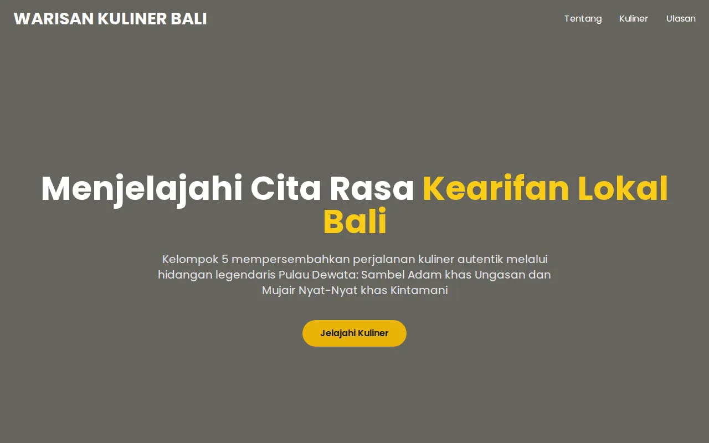
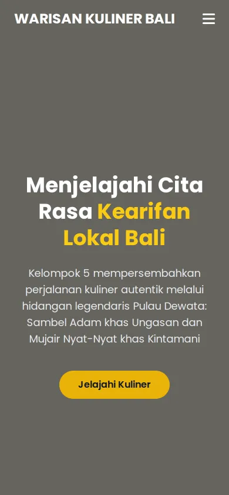

# Warisan Kuliner Bali

Website tugas P5 Kelompok 5 tentang dua kuliner tradisional Bali: Mujair Nyat-Nyat khas Kintamani dan Sambel Adam khas Ungasan.

**Buka:** [zynxx24.github.io/p5](https://zynxx24.github.io/p5/)

  
  

## Isi halaman

- Tentang kuliner khas Bali.
- Detail kedua makanan: asal, bahan, dan cara membuatnya.
- Form ulasan dengan penilaian. Ulasan dikirim ke Google Sheets lewat Google Apps Script.

## Dibuat pakai

HTML, Tailwind CSS (CDN), dan JavaScript biasa dalam satu file `index.html`. Tidak perlu build: buka `index.html` di browser. Pengiriman ulasan butuh koneksi internet.

Lisensi [MIT](LICENSE).
